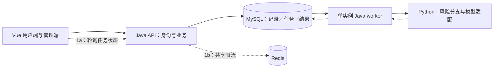

# 心屿升级：一页评审摘要

2026-11-07 · v0.3 配套 · 设计提案，待确认；本轮只整理设计与计划。

**近期交付：记录保存可靠、可选 AI 回应、近期分析与周报。** 后续支持从记录继续聊，也支持独立 AI 陪伴；用户按需使用。完整边界见[总方案](../../../ops/features/xinyu-upgrade-master-plan.md)，当前细化见[1a 设计](../../../ops/features/ai-reply-service-v1a.md)与[实施计划](../../../AI_WORKLOG/plans/2026-11-07-ai-reply-1a-plan.md)。

| 数据 / 职责 | 归属 |
| --- | --- |
| 用户身份、日记、报告、会话消息、记忆、最终任务状态 | Java / MySQL |
| 提示模板、风险分支、模型调用、后续检索与受控执行 | Python AI 服务 |
| 限流、按需缓存、未来跨实例实时事件 | Redis 辅助状态；终态回查 MySQL |

| 阶段 | 交付与退出条件 |
| --- | --- |
| **1a：单实例闭环** | 先保存、异步回应、轮询与手动重试；内部认证、总超时、版本提交、基本高风险回应可验证 |
| **1b：运行增强** | 加 Redis 限流与风险分级细化；多实例启用前补租约 / 接管；可与 2 穿插 |
| **2：近期分析 / 周报** | 近 7 / 30 天统计与回顾、周报生成和历史；依赖 1a，不依赖聊天 |
| 3：围绕记录继续聊 | 非流式多轮、历史保存、失败重试 |
| 4：独立陪伴 / SSE / 工具 | 直接聊天、增量与停止、只读资料工具、确认后存草稿 |
| 5 → 6：按需扩展 | 可控记忆 / 精选知识库 → 自动化与体验增强 |

社区治理是横向工作，按实际开放范围安排。**主线为 1a → 2，聊天允许后移。**

1a 只新增任务表，尝试次数先用字段；单进程单线程 worker，以原子领取和来源版本校验避免重复执行与旧结果回写。重启后 queued 继续，原 running 标失败，由用户决定重试。Redis、租约和跨实例广播随相应需求补上；阶段 4 单实例先直接转发 SSE。

请集中评审这五个决定：

1. 近期先交付 **1a + 2**，1b 穿插，独立陪伴保留在后续。
2. 采用 **Java 持有用户对象、Python 处理 AI** 的数据归属。
3. 初版只运行 **一个启用 worker 的 Spring Boot 进程**，中断不自动重复付费。
4. 1a 保留内部认证、总超时及可配置求助资源；部署前核验实际资源与覆盖样例。
5. 产品统计时区用 **Asia/Shanghai**；周报按当地周一至下周一，历史时间先核验再兼容。

下一步按 1a 计划开发；业务代码仍需用户确认后修改。当前未建表、未接模型、未部署。
