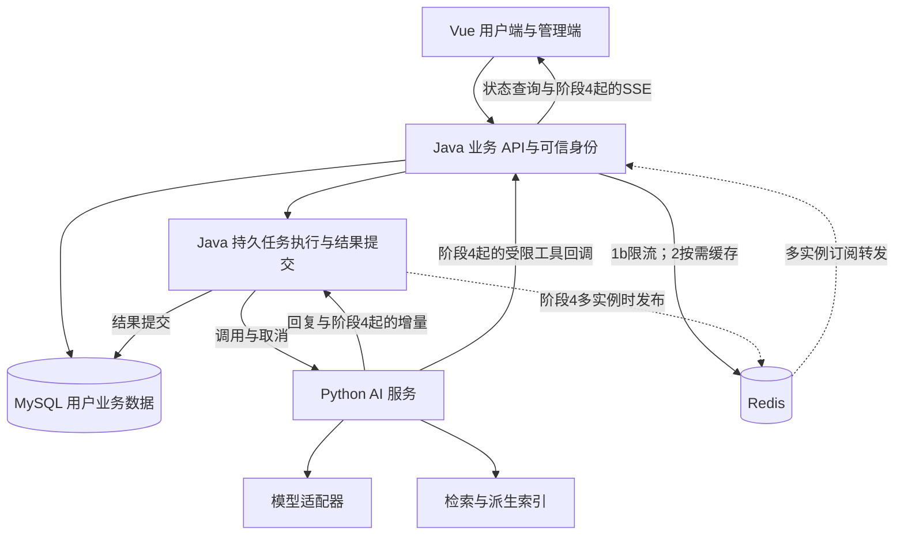

# 心屿整体升级与分阶段总方案

- 版本：v0.3，2026-11-07；根据评审拆分1a/1b；本次勘误统一软删除、版本校验与后续数据清理生命周期。
- 状态：整体分期设计基线；1a已获用户授权实施，Task1与Task2已完成本地实现／验证，Task3仅3A客户端已实现并完成回环及两条合成输入真实API验收，正在交接可读性维护。自动worker、三并发、冷却、前端接入及完整1a产品验收未完成；01任务迁移未上线，02模型名扩列另有独立执行记录。未部署，后续阶段不因此自动获得实施授权；当前进度以接续页为准。
- 阅读入口：[功能首页](README.md)；进度只在[接续状态](xinyu-next-session.md)维护，本文保留详细设计与边界。
- 用途：统一升级范围、阶段依赖和验收。确认后作为升级设计的主入口；各功能文档只细化本方案对应阶段。
- 编号约定：本文的“心屿阶段0—6”是产品升级阶段，不等于agent-lab学习路线的阶段编号。

## 1. 用户已确认的方向与本方案的选择

已确认：保留Java业务后端+Python AI服务；长期支持用户按需选择记录或AI陪伴；复杂时可先以记录为主，将继续聊后移；近期情绪分析与周报必须保留；先明确整体设计，再实施；优秀产品设计结合实际改动讲解；用户后续明确要补充Redis，并提供任务执行/事件中转架构图供评审。

本方案建议：近期交付范围为阶段1a+2，阶段1b增强可与阶段2穿插；阶段3起逐步交付聊天。用户数据的权威持久化先统一放Java业务域，Python承接AI处理；具体理由见第3节。阶段顺序、技术分工和下述边界均是此次提案，不冒充用户已批准的实现。

不直接照搬归档参考的14张表、12—14周工期或全部必做分级。后续估时依据每阶段细化和实际验收，不以日期压缩必要理解。用户没有要求当前实现全部功能。

## 2. 当前基线与目标用户流程

已查源码：登录/JWT、心情记录CRUD、可选单次AI回应、近7天按心情类型计数、社区、后台与AI回复记录已有实现。当前没有已实现的独立多轮陪伴、周报、长期记忆、知识库或业务工具模块；未检查在线数据库。

已查问题：AI生成嵌入Java同步请求；RestTemplate配置未显式设置超时；前端统一等待5秒；缺失/空模型回复可能变成默认文案并被记成功；后台AI接口直接返回包含prompt的实体。修正范围按阶段1设计，不把问题仅记为供应商不稳定。

近期闭环：

```text
记录心情 → 保存成功 → 可选单次回应
        → 查看近期统计与AI回顾 → 生成/回看情绪周报
```

后续闭环：

```text
某条记录 → 继续聊 → 多轮历史
独立陪伴入口 → 直接聊天 → 按需读取自己的记录/报告
聊天 → 整理日记草稿 → 用户确认保存
```

记录、AI陪伴和公开社区分别有自己的入口与数据边界。用户可以不聊天，也可以不写日记；后续的使用偏好不作为永久二选一模式。普通记录默认不产生新会话；直接聊天默认不自动保存成日记。

## 3. 总体架构与数据归属

### 3.1 架构提案



Java：身份、资源归属、日记、统计、报告、会话与消息等用户对象、开关/删除、任务状态、最终结果提交。浏览器只调用Java；Python无法凭模型提出的user_id获得访问权限。

Python：提示模板、输入/输出校验、模型适配、固定分析流程、受控Agent循环、记忆候选提取、检索与引用处理。通过内部认证接收Java提供的最少必要上下文，不直接读取日记业务表，不依赖agent-lab目录运行。

### 3.2 备选与推荐

| 方案 | 收益 | 代价 | 本次建议 |
| --- | --- | --- | --- |
| Java持有用户对象，Python处理AI | 日记/报告/会话的归属、删除与失效可在同一业务域管理；近期周报较易复用现有数据 | Java需要新增AI相关业务表；Python框架状态与业务对象之间需要适配 | 推荐为初始方案 |
| Java持有日记，Python持有会话/记忆/报告 | 接近此前更新参考，AI域独立演进更直接 | 导出/注销、日记修改后的报告失效、授权与跨服务失败需要额外协调 | 保留为替代方案，不与推荐方案混用 |

这不是认定第一种普遍优于第二种；本项目近期记录/分析/周报与现有Java业务关联紧密，因此优先减少跨库业务一致性。

Python可在未来维护自己的执行检查点和派生向量索引，但这些不能成为第二份用户聊天记录或权限依据。Redis按下述具体用例分阶段接入；当前不提前引入检查点库、Celery或另一套独立消息中间件。

### 3.3 数据对象按阶段创建

| 对象 | 权威归属 | 首次阶段 | 关键约束 |
| --- | --- | --- | --- |
| user、mood_record、社区表 | Java/MySQL，已有 | 现有/1 | 日记更新/删除仍检查归属；增加记录版本以关联生成结果 |
| ai_job | Java/MySQL | 1a | 单实例任务、来源版本、状态、attempt_count和最后错误；初期不单独建attempt表 |
| 租约/逐次尝试审计 | Java/MySQL | 1b按需 | 多实例前加入领取租约与持有者；需要逐次审计时再拆attempt表 |
| ai_reply | Java/MySQL，已有 | 1 | 作为单次回应结果/兼容记录；成功与失败分清，不存伪造回答；新日志不默认复制日记全文 |
| mood_report及来源关联 | Java/MySQL | 2 | 用户+报告类型+范围；保存报告版本、统计、来源ID/版本、生成状态和模板版本 |
| ai_chat_session/message/turn | Java/MySQL | 3 | 会话拥有者；source_mood_id可空；消息顺序与单轮执行状态独立 |
| ai_tool_call_log、日记草稿 | Java/MySQL | 4 | 绑定用户/轮次/工具调用ID；草稿确认只允许一次业务提交 |
| user_setting、mood_memory及删除版本 | Java/MySQL | 5 | 记忆默认关闭、来源、范围、更新/停用/删除；抑制在途旧候选回写 |
| rag_knowledge与索引任务 | Java管理原文/版本，Python派生索引 | 5 | 管理员维护公开精选知识；停用或删除后不可继续检索 |
| Redis限流计数/缓存/实时事件 | 非权威辅助状态 | 1b/2/4 | 限流按用户；缓存带来源版本与过期；事件不替代数据库终态 |
| 周期任务配置 | Java/MySQL | 6按需 | 周期幂等、失败状态、可关闭 |

列出对象不等于一次创建所有表。列、索引、迁移SQL及兼容方案在对应阶段开工前细化；只用增量迁移，不执行含DROP的初始化脚本。

### 3.4 Redis用途、阶段与消息语义

用户已明确Redis是后续要补充的技术。本方案将它列入具体阶段；接入时随实际用例解释数据结构、原子性、失效、故障与观测，不作为独立理论前置课程。这里的阶段分配是此次推荐，尚未实现。

| 阶段 | Redis用途 | 边界 |
| --- | --- | --- |
| 1b | 基础部署/客户端配置、按用户和全局的AI请求限流 | 原子计数/窗口与过期一起验证；任务互斥/幂等仍由MySQL约束与条件更新保证 |
| 2，Redis已接入后 | 近期统计等可重建结果的短时缓存 | 先测是否需要缓存，缓存key带用户、范围与来源版本；报告正文的权威版本仍在MySQL |
| 4，多实例/执行器独立后 | Java执行器→Redis Pub/Sub→Java API实例→SSE的实时事件分发 | 解决执行实例与连接实例分离；初版不承诺掉线增量重放，终态以MySQL为准 |
| 6按需 | Redis Streams事件回放，或独立任务消费/重领 | 有明确回放/分发需求才启用；分别设计游标、保留期、ACK/重领、去重与持久化 |

Pub/Sub是即时广播，订阅者不在线或处理失败可丢事件；不能承担必须恢复的任务、最终结果或唯一取消指令。阶段4单实例先直接转发；执行器与连接实例分离后采用Pub/Sub实时转发，事件携带task/turn/attempt ID与序号；缺号、断连或完成通知丢失时回查MySQL状态/最终消息。初版允许失去未保存的局部显示片段，不承诺从原token重放；该限制在页面和验收中说明。

Streams支持记录与按ID读取，但“写入Stream”不等于故障后绝不丢失，仍依赖部署的持久化/复制策略。若后续需要逐条重放，使用独立游标/合适的订阅模型；若分配后台任务，才使用消费组。一个消费组里的API实例会分摊消息，不能据此保证每个实例都收到自己SSE连接需要的全部事件。不会把Stream/PubSub视作可互换的实现。

MySQL权威边界不变：先提交任务/最终结果，再发布完成通知；发布失败不能把已提交成功改成生成失败，也不能由Redis通知抢先宣称保存成功。当前通过状态查询补偿遗漏；未来若要求可靠跨服务投递，再增加事务outbox/重投，不对每个文本delta机械套用业务事务。

Redis故障策略：普通日记保存继续可用；无法确认共享限流额度时暂缓新的付费AI执行，保留明确任务/拒绝状态，不直接无限放行；缓存失败回源MySQL；实时事件链失败时提示并回查任务状态，不自动创建第二次模型尝试。取消先记录在MySQL并由执行端检查，实时信号只用于加快传播。来源更新/软删除时递增content_version并失效缓存；软删除事务同时置status=0并失效未完成任务，结果提交另要求来源status=1。不能只等TTL自然过期继续展示应删除的内容。

Redis只接收最少事件/缓存内容，私有用户权限仍在Java检查；按环境/用户/任务隔离key或频道，设置过期/裁剪和内存上限，派生缓存与可能含回答片段的Streams必须纳入删除策略。客户端不能直接访问Redis或以猜到频道名获得订阅。

依据：2026-11-07核对[Redis Pub/Sub投递语义](https://redis.io/docs/latest/develop/pubsub/)、[Streams](https://redis.io/docs/latest/develop/data-types/streams/)、[XREADGROUP](https://redis.io/docs/latest/commands/xreadgroup/)、[持久化](https://redis.io/docs/latest/operate/oss_and_stack/management/persistence/)。具体Redis/客户端版本在实施时按现有Java/Python环境锁定，本次未安装或运行Redis。

## 4. 贯穿各阶段的执行契约

### 4.1 任务、生成结果与页面状态

生成任务基础状态：queued → running → succeeded / failed / cancelled；来源已更新则标为superseded。1a用attempt_count记录任务执行尝试，最后错误覆盖保存；Python模型是否实际调用另有明确标识。逐次模型审计在1b按需求扩展，不把任务次数直接当供应商调用次数。

日记保存成功与AI回应成功分别反馈。默认不自动再调用旧模型链兜底；失败说明可重试，不能存一段安慰话并标成生成成功。无AI开关时不创建生成任务、不产生模型调用。

任务入库后执行，不持有业务事务等待模型。1a使用Java任务表、单实例有界并发执行器（Task3待实施，需同步Python门禁）和queued→running的原子条件更新；不做租约/心跳。1b在启用多实例之前补持有者、租约和恢复互斥；单实例的启动恢复不能原样用于多实例。仅AI_WORKER_ENABLED=true且确认旧worker已停止时执行启动恢复；关闭worker的实例不恢复、不扫描/领取任务。进程重启后queued可重新领取；失去执行者的running先转为failed并记录execution_interrupted原因，待用户重试，不盲目声称模型没执行或无限重发。

同一业务输入版本只允许一个活跃任务。1a以任务类型+来源ID+来源版本唯一约束去重，失败重试原子重置同一job，领取时增加attempt_count，结果提交带预期attempt_count与来源版本；成功结果的主动再生成及通用客户端幂等键在后续有对应场景时扩展。1a不承诺把既有日记新增接口的所有重复提交问题一并解决。

### 4.2 日记更新、删除与派生结果

日记有单调增加的content_version。沿用当前代码的软删除：首次删除在同一Java事务中置status=0、content_version+1、deleted_at=本次删除时间、ai_reply_enabled=0、ai_reply=NULL，并把该来源尚未完成的queued/running/failed任务标为superseded；重复删除不再递增版本、不改deleted_at，也不创建任务。保留来源行与任务行，不把软删除误写成物理移除。生成前、提交与重试均要求来源属于当前用户、status=1、enabled=true且版本匹配；最终写回复的条件同时包含status=1与预期content_version。软删除后本人查询任务也不返回旧回复，不走unavailable重新申请路径。修改期间旧任务不得覆盖新版本；内容修改update、删除delete与结果提交complete都必须在同一实际数据库事务中先SELECT ... FOR UPDATE锁定日记，再校验并以带归属/status/版本条件的UPDATE写指定列，随后操作job；改写旧selectById→updateById整实体回写模式。锁持有到提交/回滚，网络调用在锁外；update只能改内容/心情/开关、清空回复并递增版本，不能写回status或deleted_at；任一先后都不能复活已删除来源或留下可见旧回应。retry只修改job，使用来源快照校验及带预期尝试次数的job CAS，不获取来源行锁；删除在同一事务内失效failed/queued/running，因此CAS与删除任一先后均由失效状态及最终提交校验兜住，详见1a设计。

数据保留与清理生命周期：软删除先撤销业务可见性、使在途结果失效；后续由Java业务域的定期清理任务按配置保留期硬删除或不可逆匿名化来源，连同该来源ai_job及ai_reply中的prompt、reply_content、错误正文等关联数据一起清理。处理私密心情日志须按target_type=MOOD_RECORD、target_id及user_id限定，避免误删ID相同的社区记录。派生报告、会话来源副本、缓存和Python索引按各阶段清理协议处理并记录结果；失败可重试，不能只删日记主行就宣称清理完成。本次1a迁移增加deleted_at DATETIME NULL：新增/既有有效记录为NULL，首次软删除写入；不以会随更新变化的update_time推算删除时间。迁移前已status=0的历史记录保留deleted_at=NULL并视为删除时间未知，不用迁移时刻伪造。保留期限、历史未知时间的单独处理规则、备份轮转和验证方法在“数据保留与清理”专项中确定；未来清理按deleted_at计算保留期，NULL历史行进入单独核查流程，不直接按期限批量清除。该执行机制不要求1a实现；纳入发布范围评审，由项目维护者配置并验收。

报告按来源集合的ID/版本摘要判断是否仍有效。新增/修改相关记录使已有回顾标记需要更新，仍可带明确生成时间/依据版本查看；删除来源时先隐藏其派生报告，异步清理相关文本与任务载荷，避免“删除后仍从旧报告读出内容”。会话明确附带的来源副本、摘要和记忆在对应阶段纳入同一失效/删除策略。

删除源数据、删除报告、删除对话和删除记忆是不同操作，界面需说明范围。仅删除记忆并不抹除用户仍保留的聊天历史；若要求忘记某事实，还要限制从旧来源再次提取，不能做无法兑现的全局遗忘承诺。

### 4.3 身份、资料和日志

内部服务认证与用户委托分开：Java认证浏览器，内部调用证明调用方是Java；阶段4工具回调再携带短期、限定用户/会话/能力的委托信息。Python或模型请求中的任意user_id不作为授权依据。

新日志默认记录request/trace/job/turn ID、场景、模板版本、模型、错误分类、耗时与可用用量，不打印密钥、用户原文、完整模型响应或上游异常正文。已有ai_reply.prompt不擅自清空；阶段1先改管理端VO与展示，阻止常规列表暴露全文，新记录以模板版本和受控来源引用为主。

### 4.4 风险、输出和使用范围

风险处理是各AI场景的前置/输出策略，不依赖模型自觉选择安全流程。1a提供有限规则分支：命中后跳过普通模型，返回内置关心表达、联系可信任的人与寻求陪伴的具体提示；有立即危险时提示联系当地急救或警方，不推测地区或输出电话号码。按用户2026-11-07修正，移除外部求助资源文件、核验日期和资源无效时的启动门禁；无此配置也能启动并生成普通回应。1b再细化分类/误判处理；验收检查固定回应、零模型调用及正反样例，不能把有限规则称为完整识别系统。

阶段4流式不能宣称发送后可撤回。输入先检查；输出采用受控缓冲并检查后释放，明确缓冲粒度与残余风险。若必须完整审核后才能展示，则该场景用完整回复，不把生成完再分段播放记成真模型流式。

账号/隐私/社区治理是横向工作，不把参考文档中的法律判断直接当已核验结论；开放范围和运营承诺在发布前按实际情况确认。1a不维护地区求助资源，不引入自动定位；若后续确需提供联系方式，再明确服务范围、用户地区选择和信息来源，不将其默认设为整个AI服务的启动条件。

## 5. 阶段总览与依赖

| 阶段 | 用户得到什么 | 依赖 | 退出条件摘要 | 范围级别 |
| --- | --- | --- | --- | --- |
| 0 总设计与验收基线 | 范围、架构、状态和分期清楚 | 当前源码/用户需求 | 总方案确认，阶段1可实施契约明确 | 当前任务 |
| 1a 单实例记录与回应闭环 | 先保存、异步生成、状态轮询、内置基本风险回应 | 0 | Python连通、原子状态/版本提交、失败/隐私/风险分支验证 | 近期核心 |
| 1b Redis与运行增强 | 共享限流、风险分级细化，多实例需要时加入租约 | 1a；可与2穿插 | Redis故障/并发、分类样例、多实例启用前互斥验证 | 增强；Redis保留 |
| 2 近期分析与周报 | 趋势、文字回顾、周报生成/回看 | 1a；不等待1b全部增强 | 数字正确、范围一致、报告可保存、无数据/失败/更新处理正确 | 近期核心 |
| 3 围绕记录继续聊 | 多轮对话与历史回看 | 1a；产品推进在2之后 | 至少3轮、刷新恢复、越权拒绝、失败重试不重复消息 | 后续，可延期 |
| 4 独立陪伴与受控工具 | 直接聊天、真流式与停止、按需查自己的资料 | 3，读取报告时依赖2 | 双入口独立、工具授权、流式终态与草稿确认验证 | 后续，可延期 |
| 5 可控记忆与知识库 | 可管理偏好与有来源的知识支持 | 3/4，模块可分别交付 | 开关/删除/隔离、知识停用与引用校验验证 | 按场景扩展 |
| 6 自动化与体验增强 | 自动周报/提醒、成本面板等 | 对应能力已稳定 | 周期幂等、失败可见、可关闭与成本边界验证 | 可选 |

默认主线0→1a→2，先形成近期可用版本；1b可穿插，启用多实例前完成其租约/互斥部分。阶段3—6允许延期；用户明确保留的分析和周报不能因为聊天延期被一起延期。社区治理横向线见第12节，不能静默塞到最后一个阶段。

## 6. 阶段0：总设计与验收基线

交付：本总方案、现状清单、数据权威归属推荐、接口/状态边界、各阶段验收、设计参考证据层级。当前推荐“Java持有用户对象/Python AI处理”，用户可在整体评审时选择替代方案。

开工前为阶段1补齐：迁移字段、API DTO/VO、超时总预算、输入长度、任务领取/终态、风险分支、模型参数、配置示例及测试清单。保留既有登录、社区和其他未提交改动。

验收：文档之间无相反的当前范围；周报不依赖聊天/标签/强度；近期与延期功能可一眼区分。完成设计不代表代码已完成，也不代表用户批准自动提交或上线。

## 7. 阶段1拆分：1a最小闭环，1b运行增强

### 7.1 阶段1a：单实例可用闭环

目标：保存记录立即返回；AI异步生成并可查询，失败可手动重试；内部入口有认证、总超时和基本风险回应。

数据只新增ai_job，attempt_count暂作计数，不建独立attempt表；mood_record增加content_version、ai_reply_enabled和可空deleted_at。单实例有界并发执行器（Task3待实施，需同步Python门禁）仍使用原子状态转换与条件提交，覆盖旧结果/已删除来源，不引入租约、心跳、Redis或跨实例广播。

范围：Python服务与内部DTO/认证、任务表/状态/轮询、content_version、失败不得记成功、管理端VO隐藏prompt/原始错误、前端准确状态和重试。新生成失败不把兜底文字当成正常AI回答保存。内部认证和总超时是1a底线，不因拆分后移。社区保留同步入口，但共享RestTemplate以connect=2秒/read=15秒作为待实测校准的初值；发帖与同步编辑接口单独设置Axios timeout=20秒，其他请求保留5秒。实施时先做最多5次真实模型合成样例耗时采样，再确认/调整这些配置；未采样不称为已验证阈值。生成失败不向community_post.ai_reply写兜底文字，新帖保持NULL，编辑先清掉旧内容对应回复；仅记脱敏失败日志，公开页不显示AI卡片。超时后已保存帖子仍保留，前端提示结果未确认、先刷新核对再决定是否重发；连接/读等待限制不等于整个发布请求的总截止。Task3的后端返回契约变化与Task4前端同批验收发布，二者之间不可部署。

最小风险闭环：规则命中→跳过普通生成→返回内置具体支持文案；无需外部资源、地区或核验日期，无资源配置也可启动和处理普通请求。分类细化留1b，1a验收包含固定回应、模型零调用和日记保存独立于AI结果。具体字段、接口、容量和总超时参数见[1a功能设计](ai-reply-service-v1a.md)，执行拆解见[1a实施计划](../../AI_WORKLOG/plans/2026-11-07-ai-reply-1a-plan.md)。

验收：正常/关闭AI/超时/空回答/凭据错误；重复领取只执行一次；失败重试计数和迟到结果隔离；更新/删除后不回写；重启running转失败待重试；越权轮询/重试拒绝；管理端列表无prompt全文/原始异常；高风险固定回应／零模型调用及无资源配置启动；登录/社区回归。

单实例边界：只部署一个启用worker的Spring Boot实例；queued可在重启后继续，running标execution_interrupted，默认不自动再次付费。启动恢复必须在旧执行器已停止的条件下运行。普通保存独立于AI可用性；1a只承诺此闭环，不声称解决全部并发与内容风险。

### 7.2 阶段1b：Redis、运行互斥与风险细化

接入用户已计划的Redis：原子限流、过期、故障策略与观测。1a期间限制持久排队容量、单用户活跃任务数和单任务尝试次数，Task3按供应商额度与实测配置单进程执行并发，不冒充分布式限流；当前Java worker尚未实现，Python生成门禁仍为1。

有多实例/独立执行器需求时，加入worker_owner、租约/续期、按持有者的接管恢复；CAS仍保留。需要逐次供应商审计再建attempt表，不因有计数字段就声称保留了每次详细轨迹。

风险分级细化以正反样例验证，输入/输出策略和配置资源共用，不另写第二套危机回应。Redis不可用时日记可保存，新的付费AI请求按明确策略暂缓/拒绝，不无限放行。

**危机回应增强（2026-11-09用户确认方向，排入1b，尚未实现）**

- [ ] 1a保留现有“有限正则命中→固定SUPPORT”行为；1b把命中改为触发专门的危机prompt，结合用户原文生成支持性回应，模型失败、超时或结果无效时退回现有固定文案。不因升级移除固定保底，不自动追加模型重试。
- [ ] 实施前核验当前调用链及相近成熟开源实现，再确定最小方案；内容安全API或模型分类器作为扩展识别范围的候选，按误报／漏报、额外延迟、费用和用户内容传输范围评估，不默认增加第二次模型调用。
- [ ] 单独评审返回契约与日志语义：当前SUPPORT强制model_called=false且model_name=null；“已尝试模型后固定回退”不能沿用该约束而隐瞒调用，也不能把固定文案记成模型生成成功。具体结果分类、调用标记及失败记录在1b实现前明确，不在本轮改字段或数据库。
- [ ] 为固定回退保留总deadline内的处理余量；超时取消／释放模型I/O，不额外开启一轮完整等待。验收覆盖危机生成成功、超时／失败／空或非法输出后的固定回退、比喻／否定／第三人称转述、迟到结果隔离及日志真实性。误触发仍可能存在，不把更换prompt当成已解决误判；真实模型效果和账号风控分别核验。

验收按实际启用范围进行：Redis限流原子性/过期/故障、本地到共享限流切换、风险误判样例；多实例开启之前必须完成互斥、租约过期接管与迟到结果拒绝验证。阶段2可先复用1a任务闭环，不依赖Redis或多实例设施完成。

## 8. 阶段2：近期分析与情绪周报

- [ ] **阶段2开发前评估共享数据库超时**：当前共用数据源的socketTimeout=6000ms也影响普通接口／后台查询；结合慢查询与周报负载评估语句预算、网络等待及是否需要独立worker数据源。保留连接、网络及提交／回滚等待保护，不用语句超时简单替换；本项仅评估，当前配置不变。[Connector/J定义](https://dev.mysql.com/doc/connector-j/en/connector-j-connp-props-networking.html)

目标：近期分析与周报是独立可用能力，直接依据记录生成，无需聊天或新增标签/强度。

范围：滚动近7/30天的记录次数、记录天数、情绪类型分布和时间变化；按需生成AI文字回顾；按周范围生成并保存周报，可查看历史、显式更新。现有7天计数属于基础，新增范围/文字分析/报告应分别验收。

时间：初始产品时区采用配置项Asia/Shanghai；周范围为当地周一00:00至下周一00:00的左闭右开区间。当前周显示截至统计时点的部分周；未记录的日期显示无记录。现存无时区时间字段先核验部署时区，再确定兼容查询，不能直接改写历史时间。

数据与流程：Java筛选本人有效记录并计算统计/来源版本→创建ANALYSIS或WEEKLY_REPORT任务→Python固定流程生成结构化解释→Java验证返回结构、引用ID与来源版本→保存报告并返回页面。统计数字由Java提供，模型输出不能覆盖统计字段；未经新增明确强度数据，不计算焦虑指数或情绪强度分数。

报告结构：范围、记录覆盖情况、程序统计、基于具体记录的摘要、可选轻量建议、来源记录引用、生成时间/数据版本/模板版本。材料不足要说明；来源ID合法仅证明引用来自输入，语义是否支持结论仍需抽查/评测。

数据：mood_report（类型、范围、版本、状态、统计/文字结构）及report_source（记录ID/版本）。活跃生成按用户/类型/范围/数据版本去重；同输入重复打开返回已有报告；来源更新标记过期，显式更新生成新版本。重新生成成功报告需明确用户操作，旧成功版本在新结果提交前保留。

接口族：扩展`GET /mood/analysis?range=7d|30d`读取统计/已有回顾；`POST /mood/analysis/generate`按需文字分析；`GET /mood/report/week`读取；`POST /mood/report/week/generate`创建/复用任务；`POST /mood/report/week/regenerate`显式新版本；内部对应analysis/report生成接口。GET不静默产生付费模型调用。

缓存：在统计查询重复、确有收益时使用Redis短时缓存；按用户/范围/来源版本隔离，查询仍先做身份与归属校验，源变动时失效，故障回源。缓存命中不触发模型重新生成。

页面：近期分析区域和周报入口/详情/历史；区分无数据、生成中、失败、旧报告可用与需更新。无数据不调用模型；默认不按用户每次刷新重新生成。

验收：跨日/跨周边界、多条同日记录、0/少量记录、统计与输入一致、报告刷新可回看、重复请求只生成一次活跃任务、模型失败保留旧版、来源修改/删除的失效策略、仅本人访问。抽查文字依据与语气，不把图表正确当成文字分析质量已验证。

暂缓：强度/标签前置改造、月报、导出图片/PDF、自动定时生成和推送、多轮聊天。可在本阶段保留结构扩展点，不要求空字段假数据。

## 9. 阶段3：围绕记录继续聊

目标：从某条心情进入会话，完成多轮交流与刷新回看，形成第一条聊天闭环；复杂时本阶段可整体后移，不影响阶段2发布。

数据：session有拥有者及可选source_mood_id；message有顺序/角色/状态，turn有客户端幂等键、执行状态、attempt关联。关联记录只作为本会话明确来源；不能把所有会话都绑定为必须有日记，避免阶段4返工。

流程：Java认证/校验来源→创建或打开会话→用户消息先持久化→组装受限近期历史与授权来源→Python普通对话生成→Java保存有效assistant→提交终态。单会话初期一次只运行一个turn，新输入遇到忙碌明确拒绝/提示等待，不先实现steering队列。

上下文：系统规则/当前问题/按预算截取的已完成历史/关联记录。先用明确窗口，不提前假设已有自动摘要或长期记忆；失败/取消前缀不能作为成功回答直接加入历史。

接口族：Java`/ai/session/create`、`/ai/session/page`、`/ai/session/{id}/messages`、`/ai/session/{id}/send`及受控重试；Python对话接口接收经授权的上下文。用户重试复用原用户消息和turn关联，不重复插入问题。

验收：至少3轮、刷新会话历史一致、日记源被更新/删除时按授权规则重新取当前数据或提示不可用、越权拒绝、同会话并发明确、失败可重试且消息不重复。先非流式，终态和持久化语义稳定后进入阶段4。

暂缓：独立AI主入口、SSE、工具自主调用、自动摘要、长期记忆。数据结构支持可选来源，不意味着提前开放全部入口。

## 10. 阶段4：独立陪伴、流式与受控工具

目标：用户可直接新建无日记来源的会话，也可从记录进入；双入口按需使用，并支持生成过程可见/停止与按需查资料。

入口：新增独立AI陪伴入口及会话列表。导航位置基于现有页面/移动端布局细化，不能以“记录为主”限制直接聊天。两个入口使用同一会话/消息/turn服务，来源仅影响上下文。

流式单实例：模型增量→Python事件→同进程Java执行器/API→前端SSE；执行器与连接实例分离后升级为Java执行器→Redis Pub/Sub→持有连接的API实例；关键事件含request_id/turn_id、递增序号及类型。delta仅供当前显示；final/done在Java成功提交结果后发出；error/cancelled有独立终态。前端回看以服务端保存状态为准，不把HTTP200或连接关闭当完成。

停止与断开：提供显式取消当前turn接口；初版活动聊天流断开尝试传播取消，不自动变成后台长期任务。断开只证明本地交付停止，须核对服务端终态，不能承诺供应商计算/计费停止。取消前缀标为部分内容；继续是新的受控请求尝试，复用已确认资料，不承诺原token位置续传。SSE本版不做断点重放，重连先读已保存消息/任务状态；Pub/Sub事件缺号/丢失也走此路径。Streams回放作为明确的后续选项，不与当前承诺混用。

订阅时序：触发流式执行前，持有SSE连接的API实例先建立该turn的订阅并确认就绪，再允许执行器发布增量；未能建立通道时不启动一条无人接收的付费流。订阅/转发缓冲有上限，慢连接或事件链故障转为明确中断/状态回查，不能无限堆积片段。具体握手与超时参数在阶段4接口设计中确定。

工具初版只读：get_mood_stats（7/30天枚举）、query_moods（限跨度/数量）、get_weekly_report（读取已生成报告）；Java按委托用户/会话/能力重查权限，模型不能指定别人的user_id。不存在、越权、非法参数、依赖失败分别处理；工具失败后仅允许模型如实说明，不能编造结果。

循环预算覆盖模型次数、工具次数、总时间；调用前检查剩余预算，禁止超预算后继续产生无法回传的副作用。持久记录本轮工具请求、结果状态和必要来源摘要，不能只留最终文字。

草稿：整理日记仅返回草稿；用户确认后由Java按幂等键保存。草稿确认与一般聊天分离，不默认把模型输出写成日记。此时先用显式产品确认API；只有需要跨步骤持久暂停的业务才引入LangGraph checkpoint，checkpoint不替代业务消息表。

验收：无日记直接聊、两入口复用、单实例直接转发；启用跨实例后另验分发、Redis断开/订阅恢复/事件缺号回查；共同验证真增量交付、中文跨字节解析、提交失败不发done、主动停止/断连终态、非法/越权工具、预算、重复确认不重复保存。流式审核粒度按第4.4节单独验收。

## 11. 阶段5：可管理记忆与有来源知识库

两个模块分别验收、独立开关，可按实际收益选择先后，不强迫为了完成阶段同时启用。

记忆：默认关闭；用户查看、修正、停用、删除/清空。Python按受限输入提出结构化候选，Java绑定用户/来源、校验允许类别和来源版本后提交。Core/Regular复用lab分层思路但重新设计产品key，不能原样迁移学习目标/技术栈四项。更新/删除递增memory_epoch，旧epoch的在途候选不能写回；关闭后既不读取也不继续提取。摘要、缓存、旧来源提取的删除边界纳入测试。用户记忆不进入公开社区生成。

RAG：先选管理员维护、来源明确的公开精选知识，原文/状态/版本由Java管理，Python维护可重建的切片与索引。个人日记暂不进入公共向量库。停用/删除后查询必须按有效版本过滤，索引刷新失败也不能继续返回禁用内容；嵌入/检索故障明确降级，不伪造资料支持。

回答保留实际来源快照/ID与引用检查结果；引用有效不等于语义支持。来源页可访问范围与原文删除一起设计，不把旧引用直接指向已变更文档冒充当时证据。

接口族：Java用户记忆管理与开关、管理员知识管理/索引状态；Python候选提取、检索和索引操作内部接口。外部模型得到的资料仅是数据，不改变权限/系统规则。

验收：跨用户/会话隔离、关闭、改口、删除与在途任务竞态；知识更新/停用/删除即时拒绝旧资料；空检索与依赖故障；合法/无效引用与有限真实质量对照。BGE-M3/Chroma是否用于部署由实际内存、延迟和资料规模验证，不照搬本机环境。

## 12. 阶段6与横向工作

阶段6可选：有明确需求时的Streams回放/消费组任务分发、定时周报、提醒、月报/导出、费用面板、更细模型路由、标签/强度/月历等体验增强。自动化必须复用既有生成流程与周期幂等，不能定时任务另写一套报告逻辑；没有明确需求不增加复杂调度平台。

社区治理横向线G1：保留既有发帖/评论/后台管理，独立设计举报→处理→结果反馈和必要内容过滤/隐私展示。公开内容的风险处理随该入口落实；AI陪伴延期不代表社区治理被默默删除。是否在阶段1/2并行按实际开放范围与用户确认决定，不作为周报算法的技术依赖。

社区AI异步化后续项（2026-11-09用户要求记录）：社区发帖／编辑先保存，再由后台异步生成AI回复，社区执行并发初值同样设为3、保留可配置。当前Task3的3F仍修复同步超时、失败展示与日志隐私，不插入社区异步化；后续具体阶段与时间未定。暂按心情3槽、社区另3槽理解，独立池／共用池、Python总门禁及供应商全局预算在方案设计时核验，不把用户的三并发意向当全部拓扑已确认。若独立两池同时满载可能有6条生成，不能直接复用当前Python总门禁3就宣称支持。开工前需核验社区版本、编辑／删除／关闭AI时旧结果失效、公开状态与前端回查、任务复用、重试恢复和权限，给具体接口／数据方案后再实施。当前仅记录方向，无业务代码、迁移或部署。

治理线G2：人工治理流程稳定后，再评估AI初筛给管理员建议；管理员最终决定。该模块是候选增强，不因参考提出便直接上线自动隐藏/处罚。

账号导出/注销：按实际上线范围细化。推荐方案中用户对象由Java统一管理，Python执行状态/派生索引仍须清理确认；失败保留可重试状态，不能仅返回“已删除”即假定所有副本已清理。

### 隐私告知与管理员排障（2026-11-11用户决策）

- [x] **隐私政策页面及可见入口已在本地实现（2026-11-11）**：/privacy及登录／注册／页脚入口，运营者姜秋雨、联系邮箱jianggalilieo@gmail.com由用户提供；包含下方管理员排障告知及当前数据处理边界。本地页面已验，尚未发布，不代表线上用户已经收到更新。

> 为排查AI生成、保存或状态异常，以及处理您反馈的问题，经过授权的全站管理员可能按排障所需查询相关AI调用记录，包括关联账号和记录标识、AI回复、错误详情，以及历史记录中已保存的输入或提示词。上述查询用于维护和排障，私人记录不会因此向其他普通用户公开。

本地政策页已补运营主体、联系方式、当前处理目的／方式／种类、按服务目的保存及申请删除／注销的联系渠道；说明无统一固定天数清理、页面删除不等于关联日志立即物理删除。不承诺尚未实现的访问审计或自动清理，具体数据清理与运营处理仍需按实际落实；不据此宣称整体合规。依据：[《个人信息保护法》第17条](https://www.cac.gov.cn/2021-08/20/c_1631050028355286.htm)（2026-11-11核对官方文本）。

管理员访问审计本轮暂缓，未实现；后续排入治理迭代时再确定范围，不改动现有全站ADMIN权限。

部署与观测贯穿各阶段：每阶段都准备对应服务启动、配置、健康检查、日志、数据库迁移/备份恢复与回退说明。发布前做实际环境验收；本地通过不等于线上通过，发布/提交/推送仍须用户授权。Docker在实际拓扑需要时实施，不作为全部产品功能完成前的额外理论课程。

- [ ] **容器化或动态地址部署前补全DNS成功缓存刷新**：保留当前异步DNS与失败恢复，支持后续服务迁移时通过域名更新地址；当前成功IP仍缓存到客户端关闭。届时设计可配置成功TTL与请求触发刷新、旧地址可用策略及连接池旧连接淘汰，保留查询去重、原deadline和取消隔离边界，并验证地址切换。DNS刷新不替代多实例任务的归属／租约设计。

## 13. 参考如何进入本项目

| 参考与证据层级 | 借鉴什么 | 在心屿的落点 |
| --- | --- | --- |
| pi核心固定SHA 96667f342a8da98ec7969caee7f920ace104436f | 执行循环、定稿消息与瞬时状态、取消/继续契约 | 阶段3/4，保留明确消息/turn终态，不把API名称当产品完整行为 |
| Claude Code官方工作机制/回退文档 | 用户纠正、有限恢复范围、结果验证 | 阶段1/4，失败状态和保存确认；不照搬开发终端权限 |
| Hermes官方记忆/技能文档 | 分层信息、按需加载、明确记忆生效时机 | 阶段5，评估快照/新鲜度代价，不复制文件路径与容量 |
| OpenCode官方Server/Permissions文档 | 界面与执行服务分工、动作权限 | Java/Python边界和阶段4工具授权；标准文档与V2入口分开 |
| Dify官方Workflow Studio说明 | 固定工作流与逐轮对话复用能力、分别触发 | 阶段2固定分析/报告流程与阶段3/4聊天分开，不要求部署Dify |
| LangGraph官方持久化及lab限定测试 | 检查点、长期存储与实际副作用的差别 | 仅有持久暂停/恢复需要时接入，不提前覆盖用户消息库 |

除pi已读固定部分外，多数为官方文档层面参考，尚未完成各实现的固定源码验证或产品实测；进入关键机制实现前补核验。知名度不证明设计效果，按场景验证收益和代价。

官方来源（2026-11-06/07已读，在线文档可能继续变更）：[pi固定源码](https://github.com/earendil-works/pi/blob/96667f342a8da98ec7969caee7f920ace104436f/packages/agent/src/agent-loop.ts)、[Claude Code机制](https://code.claude.com/docs/en/how-claude-code-works)、[Claude Code回退](https://code.claude.com/docs/en/checkpointing)、[Hermes记忆](https://hermes-agent.nousresearch.com/docs/user-guide/features/memory)、[OpenCode服务](https://docs.opencode.ai/docs/server/)、[Dify Workflow Studio](https://www.dify.ai/workflows)、[LangGraph持久化](https://docs.langchain.com/oss/python/langgraph/persistence)。这些链接支持对应机制说明，不是推荐边界在心屿已实测有效的证明。

## 14. 验证、工作方式与范围控制

每阶段功能文档固定列：目标/用户场景、包含/暂缓、前置依赖、文件/表/API、关键正常/失败路径、验收证据、未测项、回退办法。新行为使用有意义的RED/GREEN及相关回归；纯设计不强造RED、不跑无关全量测试。

先用预设模型HTTP和本地真实组件验证契约，再在授权范围用合成/脱敏输入做有限真实体验；不把测试数写成真实模型质量。AI文字质量用固定样例与人工复核，统计、权限、状态、幂等用程序检查。

### 14.1 模型效果评测基线（2026-11-09用户强调，后续必做）

用户明确提醒后续需要正式评测，并希望能讲清项目中的评测依据。评测围绕实际产品质量与回归建立，不为面试虚构指标；面试讨论可以从真实数据集、评分规则、失败样例、对照改动和代价提炼，但不宣称每场面试都必问。当前172项Java、114项Python属于工程验证，两条真实API调用属于配置／链路验收，尚无正式模型效果评测结果。

用户提供的细化稿已收录为[心屿项目测评计划](xinyu-evaluation-plan.md)（2026-11-09，正文保留）：按L1软件测试／L2效果／L3非功能／L4线上观测组织，计划100条合成样例，并列出候选工具、评分目标、混淆矩阵、裁判校准、统计SQL与后续观测。本文保留分期、证据与操作边界，细表以该稿供实施前核对；文档收录不代表其工具／SQL／研究引用已经验证，或新增字段／原文Trace已经获准实施。效果目标仍是建议初值，当前结果空白。

2026-11-11用户补充Java后端工程量化方向，已纳入测评计划第10～11节：SQL／索引与分页、接口响应、并发稳定性、Redis缓存、异步可靠性；保留环境、基线、分母、原始证据和前后对照，实测后再整理简历与面试表达。近期优先SQL／接口／异步，Redis到实际接入再测；正式测评仍在Task4后、完整1a发布前；当前先固定旧同步与Task3源码起点，再留存可复跑环境／数据方案，不因记录计划立即压测或付费调用。

**排期**：现在先确定要评什么、样例分类与评分字段；1a的Task3／Task4闭环后、首次完整1a发布前执行首轮小规模基线。当前继续3C主线，不插入未规划的评测平台或立即批量调用真实模型。1b危机策略增强前后在同一风险样例集上对照；后续周报、RAG、记忆和工具能力各增加对应评测，不用日记短回复得分代替这些模块的质量。

| 层次 | 主要问题 | 验证方式与证据 |
| --- | --- | --- |
| 工程正确性 | 协议、来源版本、状态、事务、权限、超时和并发是否正确 | 既有程序断言、真HTTP和隔离DB；单独统计，不计为模型质量分 |
| 回复质量 | 是否贴合原文、不臆造经历、表达自然、建议适合当前场景 | 固定输入＋明确评分锚点＋人工逐条审阅，保留失败原因 |
| 风险分支 | 该触发的是否触发、否定／转述／比喻是否误触发，输出是否遵守约定 | 有标注正反例，分开报告TP／FP／FN与误报／漏报；不以单一总准确率掩盖漏报，不证明临床识别或干预效果 |
| 运行成本 | 可用率、分类错误、延迟、用量是否可接受 | 按阶段记录耗时、超时、有效结果率、可取得的token用量；样本不足不声称稳定P95，价格／费用无依据时不估报 |

**首版最小方案（具体规模与调用预算开跑前确定）**：

1. 用户后续细化稿将数据集规划为100条合成样例，替代先前30～50条的规模建议；可先小批检查评分规则，实际模型调用数量／重复次数与预算仍在开跑前确定。来源为产品需求、已有人工检查和真实失败的合成复现；覆盖正负情绪、短输入、心情标签与正文不一致、无须建议的开心表达、否定／第三人称／比喻对照、提示注入和已发现失败。评测集仅用合成输入，不使用真实用户私密日记；后续反馈若要回流，须另行解决隐私与合成复现边界。按场景统计覆盖，13种心情枚举通过不等于13类语义质量已验证。
2. 每条记录case_id、场景、输入、预期MODEL／SUPPORT、必须满足／不得出现的行为及标注理由；不要求回复与一段标准答案逐字一致。把调prompt的开发集与最终检查的保留集分开，坏例可加入回归但不能反复调同一保留集后还称独立验收。
3. 程序检查结构、类型、长度、结果分支与调用元数据；人工按贴合度、事实忠实、表达和建议适当性分项评分，实施时先写清每档锚点和少量示例。危险建议、泄露或明显违背约定单列严重失败，不用其他高分抵消。
4. 首版以程序检查＋人工审阅为主，不强制增加LLM裁判。后续确有样本量需要再引入LLM-as-judge，先与人工评分对齐、复核分歧并检查顺序／长度偏差，记录裁判模型／prompt版本；不让被测模型自评分自动等于真实质量，也不把Codex评价当用户亲自标注。
5. 冻结当前模型／prompt／参数为基线，一次只改一个主要因素；在同一输入与评分规则下比较旧／新版本，记录逐条胜负／持平、错误变化及延迟／用量代价。主观对比尽量隐藏版本身份并交换候选顺序；关键边界可少量重复运行观察随机波动，重复次数与付费上限提前确定，不自动失败重试凑成功率。
6. 保存数据集版本、模型名称及可获得的实际版本、模板／代码版本、采样参数、日期、每条输出／评分／错误／耗时和汇总分母。超时／非法输出不能从失败率分母消失；回复质量分若只对有效回复统计，必须同时报告有效率与无效数。不在看到结果后再选一个好看的通过阈值。
7. 首轮交付可复跑的评测命令、固定样例、评分表、分类汇总、代表性失败及一次有依据的改动对照。后续更换prompt／模型／安全规则时跑对应回归；新的付费批次单独核对样例数、预算和授权，当前两次调用授权不扩张为整套评测授权。

**后续模块的增量指标**：周报验证统计与引用支持结论、材料不足时不过度推断；RAG分开查检索相关性／召回与答案依据；记忆查提取准确、过期与删除隔离；工具调用查选工具、参数、授权与最终副作用。仅在模块落地时定义具体样例和基线，不现在堆一套无实际对象的指标。

参考方法：[Anthropic《Demystifying evals for AI agents》](https://www.anthropic.com/research/demystifying-evals-for-ai-agents)（2026-01-09，官方工程文章）区分程序、模型与人工评分，建议小规模真实问题起步并校准模型裁判。本节是结合心屿的规划，不是第三方框架源码实测，也不是已经取得评测结果；选具体评测工具前再核验当前实现与成本，首版不要求新平台。

可据实准备的项目追问：为什么选这些样例？好回复怎么定义？如何减少标注／裁判偏差？改prompt凭什么说改善？失败、随机性、延迟和费用怎么一起看？当时哪些是用户判断／标注，哪些由Codex提供？答案只用实际完成的证据，不把规划写成经验。

每次修改围绕当前阶段的小闭环带读，说明解决什么、怎么执行、为何这样取舍、如何验证。不要求用户先读完产品专题或手写全部样板，也不因框架学习过就全部接入。

执行前更新对应功能文档、增量迁移和测试方案；用户确认范围后再改业务代码。完成一个阶段不自动批准下阶段的额外范围，也不自动提交/部署。若需求变化，先更新本总方案和当前功能文档，不能只追加一个“最新”段落造成多套并行口径。

## 15. 旧材料与当前状态

- [旧路线与早期功能草稿](../../docs/history/README.md)已归档；`ops/05-roadmap-agent-rag.md`仅保留入口，不再维护另一套阶段表。原一页摘要合并至功能首页，历史原文保留。
- 2026-11-05更新参考全文保留；其中Python拥有全部AI业务表、周报放聊天之后、标签/强度作为周报依赖等，均未确认为实施基线。本提案给出不同选择和理由。
- agent-lab的《心屿接入首轮方案》是此前同步单次调用的局部草案；若本总方案确认，阶段1异步保存/任务状态设计替代其同步超时与prompt原文日志建议。
- 《心屿整体设计讨论》保留用户方向澄清；阶段范围以本方案为集中提案。agent-lab学习进度与测试基线仍以其正式学习路线为准。
- 当前实施进度见[接续状态](xinyu-next-session.md)：1a Task 1 已完成，本地测试不代表完整 1a 或生产验收。以下版本评审记录保留其当时上下文，不作为当前进度。

整体设计的关键取舍是近期交付1a+2且1b穿插、后续聊天可延期、Java持有用户对象/Python处理AI、单实例恢复，以及安全资源/社区治理发布边界。1a计划已按用户授权开始执行；用户仍可调整后续阶段，本方案不构成自动部署或扩大实施范围的授权。

设计准备复核：2026-11-07独立只读审阅未提出阻碍制定阶段实施计划的关键问题。该结论不等于用户确认、实现验证或生产验收。

变更记录：v0.2依据用户明确的Redis接入意向与所附图，补充分阶段Redis用途、实时事件链、Pub/Sub与Streams区别及故障边界；阶段0—6编号与近期分析/周报优先级保持一致。v0.1独立审阅只覆盖此前版本，本次修订另行检查。

v0.2准备复核：独立只读审阅未提出Redis修订的关键设计缺口；另自查补充了先订阅就绪再发布与有界缓冲要求。仍未安装或运行Redis，语义依据为官方文档。

变更记录：v0.3采纳单人交付评审建议：阶段1拆为1a/1b，attempt先计数字段，单实例直连/轮询与未来扩展分开；新增一页摘要，产品时区改Asia/Shanghai，1a补可配置求助资源验收。本文审阅记录按对应版本理解，修改不是运行验收。

v0.3准备复核：独立只读审阅覆盖本版总方案、一页摘要与1a设计，未提出阻碍实施规划的关键疑问；1a实施计划另作逐项自查。该记录不代表运行验证或用户确认。

软删除勘误（2026-11-07）：按当前delete()仅置status=0的源码修正1a物理删除假设；统一删除递增版本、未完成任务失效、提交/重试/查询检查status=1，补数据清理生命周期、移除不存在的管理端详情验收对象，并登记旧路线同步要求。本次勘误已作跨文档自查，先前独立审阅仅覆盖勘误前版本；尚未修改业务代码。

删除实现补充（2026-11-07）：1a一并设计deleted_at；明确删除与提交先SELECT ... FOR UPDATE、再条件更新指定列，新增首次删除时间、重复删除不改时间、事务回滚与锁竞争的计划验收。仅更新设计与计划。

实施计划补充（2026-11-07）：update纳入来源行锁/指定列更新，补防复活测试；社区同步AI补共享客户端超时；明确Task3/4发布边界、worker启用时才恢复，以及retry的job CAS与删除竞态证明。仅修文档，未开始业务实现。

社区等待策略更正（2026-11-07）：撤回未经测量的2秒读等待；改为后端2秒连接/15秒读等待、社区发布/编辑20秒前端等待的待校准初值，并要求小量真实模型耗时记录。社区失败不存/展示兜底回复。此次仅改设计与计划，未做模型采样或业务改动。

风险回应简化（2026-11-07，用户确认）：更新第4.4节及1a范围／验收，取消地区资源文件、核验日期和90天启动门禁，改为内置支持性回应；前文版本回顾中“可配置资源”仅描述旧设计。本次不改变有限规则覆盖范围或其他阶段的权限、事务和版本约束。


### 心情表达后续项（2026-11-07用户确认）

本轮先支持12种心情＋其他的具体情绪单选，选择器用无标题间距分成5项与8项，其他并入末组；暂用纯文字，避免重复图标和正向／负向标签。情绪强度、多选将在后续结合实际记录和统计需求单独设计；目前不改变moodType字符串、表结构或计数口径，不将候选方案视为已实现。

2026-11-09补充：用户已补齐13项小芽表情并授权接入，当前新增／编辑选择器、日记卡片及详情已使用一一对应的表情，保留文字与原分组；仅选中项使用动态版。静态default／love用于现有空状态，favicon已同步，未来场景不强行占位。先前“暂用纯文字”是补齐素材之前的决定，AI状态表情仍遵守下节排期。


### 阶段2统计呈现修订与1a后的表情接入（2026-11-07）

- 阶段2处理主心情并列：相同最高次数不能任意挑一项称“记得最多”，应明确并列或不显示单一最高项；当前展示问题已识别，尚未修复。
- 近期统计改为按次数排序的横向条形图，仅显示出现过的心情；默认前5项，其余通过“更多”展开。可按两组柔和色系区分展示，但不渲染“情绪好坏”判断；没有强度数据时仍只计记录次数，不把次数转成强度。
- 小芽静态品牌素材先接favicon、导航／登录logo及默认头像；本轮不为缺失的13项表情强行重复映射。
- xiaoya-thinking（排队／生成中）与xiaoya-reply（AI回复头像）安排在1a闭环跑通后的单独前端迭代。不要塞入Task4；Task4优先完成轮询、迟到回包、重试和联调。SUPPORT／风险回应仍不显示卡通表情。
